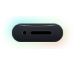

# 🏝️ Aura Island — Apple "Liquid Glass" Hub for Windows

<div align="center">



**A native Windows Dynamic Island productivity and developer hub inspired by Apple's iOS 26 "Liquid Glass" design.**  
Built with modern **C++20**, **Qt 6.7+** (Qt Quick / QML), **Win32 DWM / Windows 11 Acrylic**, and **C++/WinRT**.

[](https://github.com/USER/aura-island/actions/workflows/build.yml)
[-blue.svg)](#)
[](#)
[](#)
[](#)

</div>

---

## ✨ Features & Architecture

### 🔮 Window Architecture & Safety
- **True Island Geometry**: A single frameless, transparent, always-on-top window positioned **8px from the top edge** of the primary display.
- **Never Steals Focus (`WS_EX_NOACTIVATE`)**: Clicking buttons, copying snippets, or switching tabs inside the island never takes typing focus away from your code editor or browser.
- **Hidden from Taskbar & Alt+Tab (`WS_EX_TOOLWINDOW`)**: Floats unobtrusively like a hardware feature.
- **Zero-Latency Click-Through**: Built with native Win32 `SetWindowRgn` hardware clipping and cursor proximity evaluation (`30ms`). Clicks outside the visible pill pass directly to underlying windows.
- **Dynamic Native Resizing**: The native window resizes synchronously with the island state:
  - **Idle**: Compact pill (`120x32px`, radius 16) with subtle specular sheen and LED camera sensor cutout.
  - **Compact**: Status capsule (`260x36px`, radius 18) displaying unread email count, Pomodoro countdown, and currently playing media with animated equalizer bars.
  - **Expanded**: Full productivity workspace (`560x340px`, radius 32) with liquid sliding tab navigation.
  - **Drop Mode**: Glowing animated border drop zone (`400x140px`, radius 24).
- **Fullscreen Auto-Hide (`SHQueryUserNotificationState`)**: Island automatically hides when you play games, watch fullscreen video, or present slides, and smoothly returns afterward.
- **Crash-Safe Watchdog Supervisor**: Automatically restarts the island process up to 3 times per minute if an unexpected crash occurs.

---

### 🎛️ Daily Productivity Tabs

| Tab | Capability |
| :--- | :--- |
| **🗂️ Shelf** | Drag files, images, links, or text from anywhere into the island. Persistent storage in SQLite. Drag items OUT into other apps with standard MIME data. Open, copy paths, pin, and delete. |
| **📋 Clipboard** | Event-driven clipboard monitor using `AddClipboardFormatListener` (zero polling overhead). Keeps last 30 items. Automatically detects and ignores sensitive password manager copies (`Clipboard Viewer Ignore` / `ExcludeClipboardContentFromMonitorProcessing`). Search and 1-click re-copy. |
| **📝 Notes** | Quick notes & code snippets with language badges (`cpp`, `python`, `js`, etc.), monospace code viewer, tags, and 1-click code copy. |
| **📬 Gmail** | Google OAuth 2.0 with PKCE & loopback HTTP handler. Shows latest 5 unread emails with sender, subject, date, and snippet. Open in browser, mark as read, or archive directly. Refresh tokens securely stored in **Windows Credential Manager**. |
| **💻 Dev Hub** | • **Git Watcher**: Background status monitor displaying active git branch and uncommitted files count.<br>• **Pomodoro Timer**: 25/5 focus cycles with live countdown on the compact island.<br>• **Claude Code / Codex Agent Hook**: Local HTTP server (`127.0.0.1`) receiving agent events. Displays status, allows/denies dangerous actions, and rings a soft chime when tasks complete. |
| **🎵 Media** | C++/WinRT integration (`GlobalSystemMediaTransportControlsSessionManager`). Reads current track title, artist, album, and controls Play/Pause/Next/Previous. Miniature animated equalizer on the compact island. |
| **⚙️ Settings** | Custom accent color tints (iOS Blue, Purple, Orange, Green, Rose, Cyan), global hotkey toggle (`Ctrl+Alt+Space`), Windows startup auto-launch toggle via Registry. |

---

## 🚀 How to Build & Download from GitHub Actions (No Local Setup Required)

You do **not** need Visual Studio or Qt installed on your local computer. GitHub Actions compiles the complete C++20 / Qt 6.7 application in the cloud and packages `AuraIsland-win64.zip`.

### Step 1: Push This Code to Your GitHub Repository
Run these commands in PowerShell or Terminal inside this directory:
```powershell
# 1. Add all project files
git add .

# 2. Commit
git commit -m "feat: initial commit of Aura Island native Windows app"

# 3. Add your GitHub remote repository (replace USER and REPO with yours)
git remote add origin https://github.com/USER/aura-island.git

# 4. Push to main branch
git push -u origin main
```

### Step 2: Download the Compiled `.exe` from GitHub Actions
1. Open your repository on GitHub in your web browser.
2. Click on the **Actions** tab at the top.
3. Click on the latest workflow run: **Build Aura Island**.
4. Scroll down to the **Artifacts** section at the bottom of the summary page.
5. Click **AuraIsland-win64** to download `AuraIsland-win64.zip`.
6. Extract the zip file and run `AuraIsland.exe`!

### Step 3: (Optional) Create a Versioned Release
Whenever you push a git tag like `v1.0.0`, GitHub Actions automatically creates a public GitHub Release with the zip attached:
```powershell
git tag v1.0.0
git push origin v1.0.0
```

---

## 🔑 Gmail Integration Setup (Google Cloud OAuth 2.0)

To connect your Gmail account:
1. Go to the [Google Cloud Console](https://console.cloud.google.com/).
2. Create a new project (e.g. `Aura Island`).
3. Under **APIs & Services** > **Library**, enable the **Gmail API**.
4. Under **APIs & Services** > **OAuth consent screen**:
   - Select **External**, set App name to `Aura Island`.
   - Add your Google account under **Test Users**.
   - Add scopes: `https://www.googleapis.com/auth/gmail.readonly` and `https://www.googleapis.com/auth/gmail.modify`.
5. Under **APIs & Services** > **Credentials**:
   - Click **Create Credentials** > **OAuth client ID**.
   - Application type: **Desktop app**.
   - Name: `Aura Island Client`.
6. Download the client JSON or copy the **Client ID** and **Client Secret**.
7. Save it to `%APPDATA%\AuraIsland\gmail_credentials.json` with this format:
```json
{
  "installed": {
    "client_id": "YOUR_CLIENT_ID.apps.googleusercontent.com",
    "client_secret": "YOUR_CLIENT_SECRET"
  }
}
```
*(Alternatively, set the environment variables `GMAIL_CLIENT_ID` and `GMAIL_CLIENT_SECRET`)*.

---

## 🤖 Claude Code & AI Agent Hook Integration

Aura Island includes an embedded local webhook server bound strictly to `127.0.0.1:19827`. You can configure your local AI tools (Claude Code, Codex, Cursor, custom scripts) to report progress and request approval.

### Hook Example: Send Progress Update
```bash
curl -X POST http://127.0.0.1:19827/api/hook \
  -H "Authorization: Bearer <YOUR_TOKEN>" \
  -H "Content-Type: application/json" \
  -d '{
    "agent": "Claude Code",
    "status": "working",
    "message": "Refactoring database migrations..."
  }'
```

### Hook Example: Request Approval (Blocks Until You Click "Allow" or "Deny")
```bash
curl -X POST http://127.0.0.1:19827/api/hook \
  -H "Authorization: Bearer <YOUR_TOKEN>" \
  -H "Content-Type: application/json" \
  -d '{
    "agent": "Claude Code",
    "status": "needs_approval",
    "action": "execute: rm -rf ./tmp/cache",
    "message": "Agent needs permission to clear build cache."
  }'
```
*Aura Island automatically pops up with "Allow" and "Deny" buttons and returns `{"decision": "allow"}` or `{"decision": "deny"}` to the caller.*

### Hook Example: Task Finished
```bash
curl -X POST http://127.0.0.1:19827/api/hook \
  -H "Authorization: Bearer <YOUR_TOKEN>" \
  -H "Content-Type: application/json" \
  -d '{
    "agent": "Claude Code",
    "status": "done",
    "message": "All 18 unit tests passed successfully."
  }'
```
*Aura Island plays a soft system chime and shows a success notification toast.*

---

## 📦 Installation & Setup

### How to Install
1. Download `AuraIsland-Setup-<version>.exe` from the latest GitHub Release or Workflow Artifacts.
2. Run the installer:
   - Choose installation scope (per-user or all users into `C:\Program Files\Aura Island`).
   - Optionally check "Start Aura Island when Windows starts" to enable auto-start on boot.
   - Click **Finish** to automatically launch Aura Island.
3. **Windows SmartScreen Note**: Because the installer is freshly compiled and not code-signed with an expensive commercial EV certificate, Windows SmartScreen will display an alert:
   - Click **"More info"**
   - Click **"Run anyway"**
   *(Code signing with a trusted certificate can be integrated into your CI/CD pipeline if desired).*

### How to Uninstall
1. Open Windows **Settings** > **Apps** > **Installed apps** (or `appwiz.cpl`).
2. Search for **Aura Island** and click **Uninstall**.
3. The uninstaller will ask:
   > *"Do you also want to delete your personal notes, settings, and clipboard database?"*
   - Select **No** (default) to keep your notes and database safe for future reinstalls.
   - Select **Yes** if you wish to perform a complete wipe of all local data in `%APPDATA%\Aura\AuraIsland`.

---

## 🛠️ Local Build (Optional)

If you ever wish to build locally on a Windows machine:

### Prerequisites
- Visual Studio 2022 (with "Desktop development with C++" and Windows 10/11 SDK)
- CMake 3.22+ and Ninja
- Qt 6.7+ with modules: `Quick`, `Qml`, `NetworkAuth`, `Sql`, `Widgets`

### Build Command
```powershell
cmake -B build -G "Ninja" -DCMAKE_BUILD_TYPE=Release
cmake --build build --config Release
windeployqt --qmldir qml build\AuraIsland.exe
```

---

## 📄 License
MIT License. Created for native Windows productivity.
